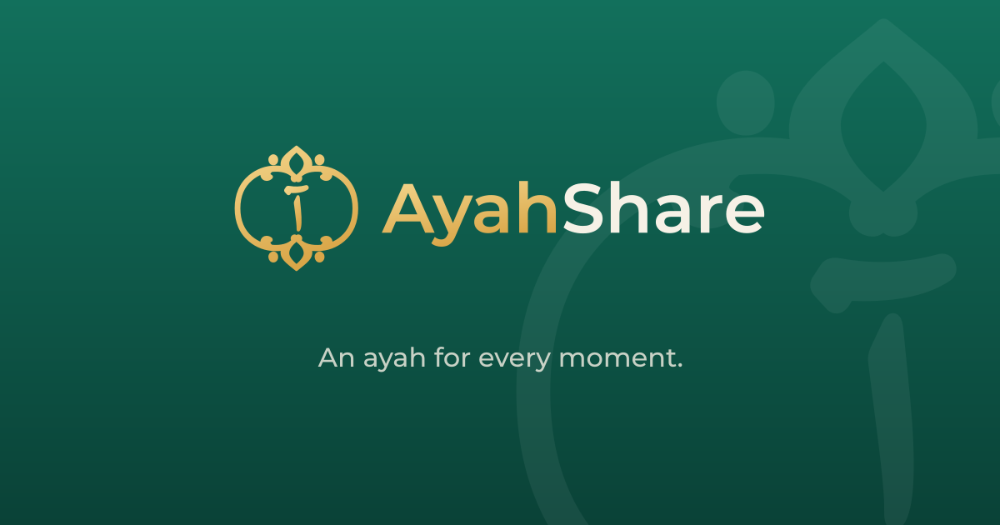
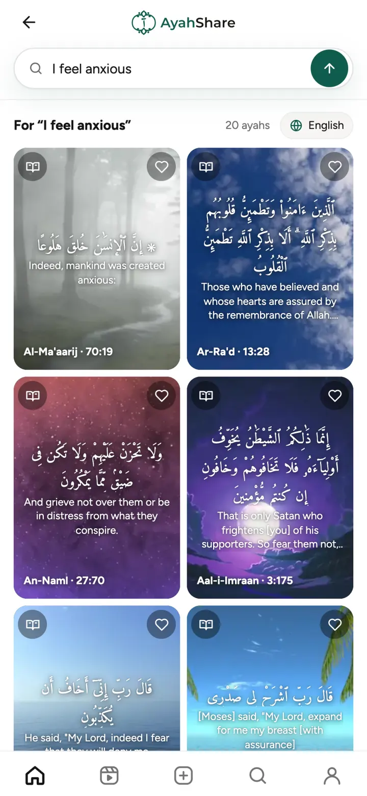
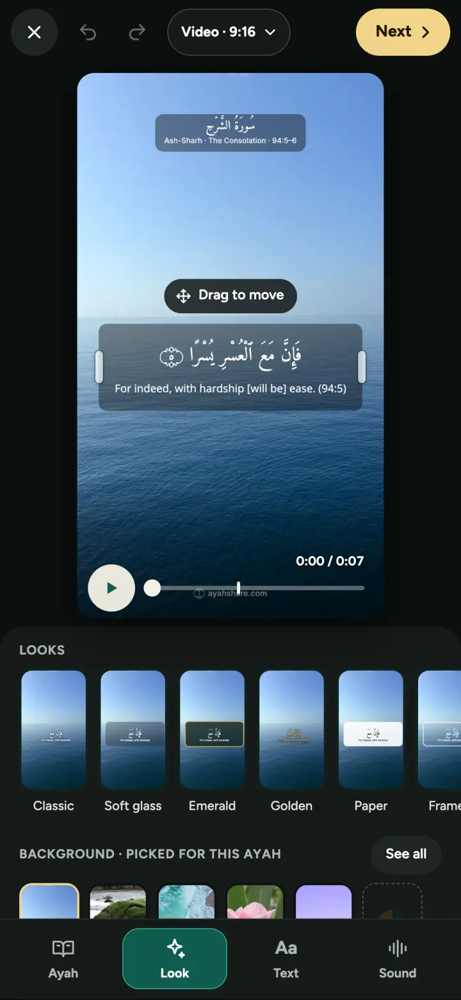
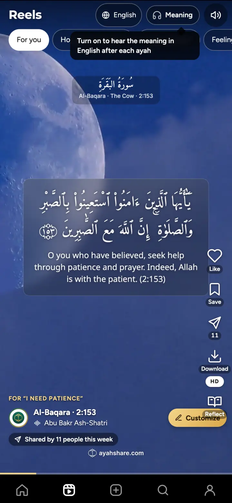

<p align="center">
  <a href="https://ayahshare.com"></a>
</p>

<p align="center">
  <a href="https://ayahshare.com"><b>ayahshare.com</b></a> ·
  <a href="https://ayahshare.com/app">Open the app</a> ·
  <a href="https://play.google.com/store/apps/details?id=com.ayahshare.app">Android</a> ·
  <a href="#getting-started">Run it locally</a> ·
  <a href="CONTRIBUTING.md">Contribute</a>
</p>

<p align="center">
  <a href="LICENSE"></a>
  <a href="https://github.com/amjadhex/ayahshare/actions/workflows/ci.yml"></a>
  
</p>

# AyahShare

Make a short, beautiful video of a Quran verse — recitation, Arabic text, translation and a calm background — and share
it to WhatsApp status, Instagram or anywhere else. Live at **[ayahshare.com](https://ayahshare.com)**, and as an app for
iOS and Android.

<p align="center">
  
  &nbsp;
  
  &nbsp;
  
</p>

This repository is the whole product: the web app (also bundled into the iOS and Android apps), the API, the admin
dashboard and the offline content pipeline. It is free software under the [GNU AGPL-3.0](LICENSE).

## What it does

- **Find a verse by feeling, topic or memory.** "I am sad", "patience", "the verse about the ant": semantic search over
  every ayah (embeddings + Cloudflare Vectorize), with a small model that reads what a feeling or situation is really
  after and ranks consoling verses over ones that merely contain the word.
- **Design it.** Quran fonts, text effects (shade, glass, solid, outline, shadow), Auto contrast that measures the
  background behind the text, long ayahs split at the mushaf's pause marks, fade / rise / zoom animations.
- **Make the video on the device.** The page draws the text layers once; a worker composes every frame and encodes
  H.264 + AAC with WebCodecs ([mediabunny](https://github.com/Vanilagy/mediabunny)), synced to each ayah's recitation.
  Videos are encoded at ~1.5 Mbps, light enough that WhatsApp status sends them untouched (heavier files get shrunk to
  720p and re-encoded, which breaks thin Arabic strokes).
- **Reels, reflect and remember.** A feed of ready-made verse videos, tafsir and reflections (Quran Foundation API),
  translation voices (e.g. Malayalam), a daily ayah with web push reminders, accounts with Google, Apple or an email
  code, share links with previews.

## Repository layout

| Path | What | Stack |
|---|---|---|
| [`apps/web`](apps/web) | The editor, feed and share pages (PWA), and the canvas renderer and video export engine | React 19, Vite, TypeScript |
| [`apps/api`](apps/api) | API and static hosting: search, auth, shares, admin API, crons | Cloudflare Workers (Hono), D1, R2, Vectorize |
| [`apps/admin`](apps/admin) | Owner dashboard: metrics, content, backgrounds, library switches | Vite + TypeScript, no framework |
| [`apps/mobile`](apps/mobile) | iOS and Android apps: the web build bundled with Capacitor | Capacitor 8 |
| [`apps/www-redirect`](apps/www-redirect) | Redirects `www.` to the apex domain | Cloudflare Worker |
| [`contracts`](contracts) | Types and lists shared by web and API (recipes, reciters, voices) | TypeScript |
| [`pipeline`](pipeline) | Offline jobs: ayah data, search index, topics, background library, translations, reciters | Python |
| [`legal`](legal) | Privacy, terms, support and account-deletion pages (copied into `apps/web/public`) | HTML |

Each app has its own README with the details.

## Getting started

Requirements: Node.js 24 and npm. For the pipeline: Python 3.11+ and ffmpeg.

```sh
# Web app against the public API (no Cloudflare account needed)
cd apps/web
npm install
API_TARGET=https://ayahshare.com npm run dev     # http://localhost:5173
npm test                                         # unit and component tests
npm run build                                    # strict type check + production build

# API
cd apps/api
npm install
npm test                                         # Workers runtime tests (vitest-pool-workers)
npm run dev                                      # wrangler dev (needs your own Cloudflare resources, see below)

# Admin dashboard with made-up data
cd apps/admin
npm install
npm run mock                                     # http://localhost:8788/admin/
```

## Running your own copy

AyahShare runs entirely on Cloudflare. To deploy your own:

1. Create a D1 database, an R2 bucket and two Vectorize indexes (384 dimensions), and put their names and the database
   id in [`apps/api/wrangler.jsonc`](apps/api/wrangler.jsonc). Set `ADMIN_EMAILS`, your domain (`routes`) and, if you
   use them, the sign-in and app-link values there.
2. Apply the migrations: `npm run db:migrate` in `apps/api`.
3. Set the secrets listed at the end of `wrangler.jsonc` with `wrangler secret put` (at least `OPENROUTER_API_KEY` and
   `ADMIN_TOKEN`; sign-in, push and tafsir features switch on as their keys are set).
4. Build the content with the [pipeline](pipeline/README.md) (`a1_ayahs.py` … `a5_suggest.py`): ayah data, the search
   index and the background library. Keys go in a `.env` at the repo root; `pip install -r pipeline/requirements.txt`.
5. Deploy: `npm --prefix apps/admin run build`, then `npm --prefix apps/api run deploy` (builds the web app and runs
   `wrangler deploy`).

Please give your copy its own name and logo (see [Trademarks](#trademarks)).

## Contributing

Bug reports, fixes and translations are welcome. Read [CONTRIBUTING.md](CONTRIBUTING.md) first. Security issues: see
[SECURITY.md](SECURITY.md).

## License

Copyright © 2026 Amjad Ali and contributors.

The code is licensed under the [GNU Affero General Public License v3.0](LICENSE). If you run a modified version as a
network service, you must offer its source to its users.

Quran text, translations, tafsir, recitations, background videos, book covers and fonts are not part of this license.
They come from their own sources under their own terms; see [NOTICE.md](NOTICE.md).

### Trademarks

"AyahShare" and the AyahShare logo are trademarks of the project's maintainers and are not licensed under the AGPL.
Forks and other deployments must use a different name and logo.
